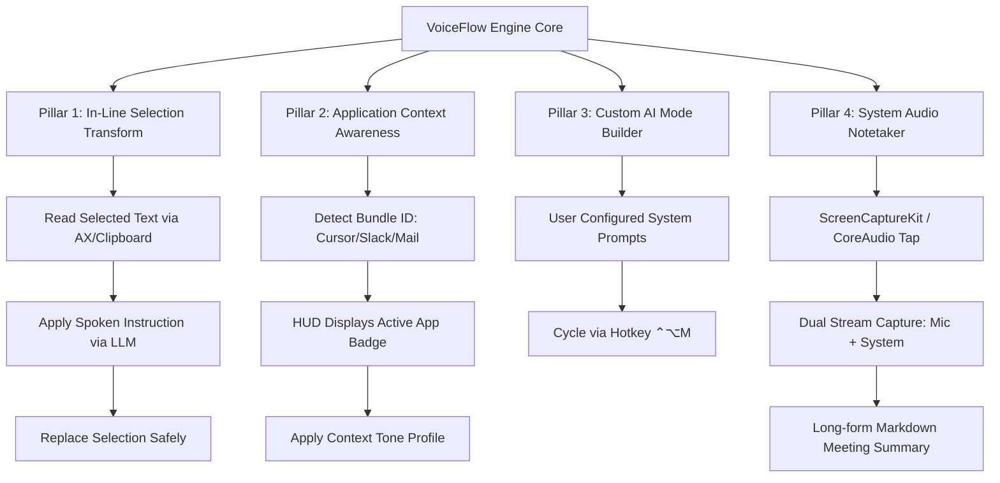

# sanblueᵈᵒᵗ VoiceFlow — Competitive Evolution & Capability Proposal

> **Status:** Proposal for Phase 6+ Capability Roadmap  
> **Platform:** macOS first (Apple Silicon / Intel), Windows platform adapter downstream  
> **Date:** 2026-09-03  
> **Benchmark Sources:**  
> - Wispr Flow: `https://wisprflow.ai/`  
> - Superwhisper: `https://superwhisper.com/`  
> - VoiceDash: `https://voicedash.ai/`  
> - VoiceInk: `https://tryvoiceink.com/`  

---

## 1. Executive Summary & Purpose

`sanblueᵈᵒᵗ VoiceFlow` is an offline-capable, push-to-talk personal dictation system with a retro dev-station interface, conservative local text cleanup, optional Gemini cloud fallback, and deterministic voice actions.

This proposal evaluates the leading modern voice-to-text applications (`Wispr Flow`, `Superwhisper`, `VoiceDash`, and `VoiceInk`) to identify capability gaps, architectural differentiators, and high-impact feature opportunities. It defines the implementation roadmap for next-generation features while strictly preserving VoiceFlow's non-negotiable core principles: **local-first privacy, literal before clever, measured telemetry (R9), transparent mode states, and zero silent modifications**.

---

## 2. Competitive Benchmark Matrix

| Feature / Architecture | Wispr Flow | Superwhisper | VoiceDash | VoiceInk | VoiceFlow (Current) | VoiceFlow (Proposed) |
| :--- | :---: | :---: | :---: | :---: | :---: | :---: |
| **Transcription Engine** | Cloud-based Whisper fine-tune | Local (WhisperKit / CoreML) + Cloud API | Cloud API | 100% Local (WhisperKit / Parakeet) | Local `whisper.cpp` | Local `whisper.cpp` + WhisperKit evaluation |
| **Text Cleanup / Rewriting** | Cloud LLM style adaptation | Customizable prompt modes (Local/Cloud) | Role-based cloud presets | Local AI filler removal | Local Ollama (`qwen3:4b`) + Cloud Gemini | Local Ollama + Cloud Gemini + Custom Mode Builder |
| **Privacy & Data Retention** | Cloud processing (SOC2) | Local on-device / Cloud zero-retention | Cloud processing | 100% On-device, no cloud required | 100% Local by default; explicit cloud opt-in | 100% Local default; credential in Keychain |
| **Telemetry & Latency Display** | WPM stats (cloud) | Basic status | WPM calculator | None | Measured HUD & Station Console (R9) | Live HUD latency & rate badge (Feature 10) |
| **Trigger & Arming Delay** | Push-to-talk | Global hotkey toggle / hold | Global shortcut | Push-to-talk | Configurable Fn/Globe hold delay + Take-back | Fn/Globe hold delay + Take-back + Escape cancel |
| **Target App Context Awareness** | Automatic silent tone switch | Manual preset selection | Role/App presets (Cursor, Slack) | None | Tracked in station window only | **App-aware tone profiles with explicit HUD badge** |
| **In-Line Selection Transform** | Yes (Select text → dictate edit) | Yes (Transform selection via AI prompt) | No | No | Not implemented | **"Transform Selection" voice rewriter mode** |
| **Snippets / Smart Expansion** | Writing style learning | Custom prompt macros | Short text expansion | Smart Replace | Deterministic snippets (`snippets.py`) | Deterministic snippets + phonetic aliases |
| **Continuous Meeting Recording** | Flow Notetaker (Mic + System audio) | Meeting Mode (Dual-audio capture) | No | Note structuring | Push-to-talk meeting notes (R3b) | **Dual-channel continuous Notetaker** |

---

## 3. Detailed Competitor Analysis

### A. Wispr Flow (`https://wisprflow.ai/`)
- **Strengths:** 
  - Rapid dictation throughput (benchmarked up to 220 WPM vs 45 WPM typing).
  - Context-aware formatting per application (Slack, Gmail, Claude, Cursor, Notion).
  - In-line editing commands over highlighted text.
- **Vulnerabilities / Deviations from VoiceFlow Philosophy:**
  - Cloud dependency: audio and text stream to cloud servers.
  - Silent alterations: rewrites sentences without explicit user visibility over what rules changed the text.

### B. Superwhisper (`https://superwhisper.com/`)
- **Strengths:**
  - Hybrid architecture with local CoreML/WhisperKit on Apple Silicon and flexible multi-provider cloud fallback (OpenAI, Anthropic, Gemini, Groq, Mistral).
  - Custom AI Modes: users configure tailored system prompts (e.g. Email mode, Code mode, Meeting notes, Bullet points).
  - System audio capture for recording meetings.
- **Vulnerabilities / Deviations from VoiceFlow Philosophy:**
  - Unconstrained prompt injection risk if user prompts override safety guardrails.

### C. VoiceDash (`https://voicedash.ai/`)
- **Strengths:**
  - Distinct profiles for developer workflows (Cursor/VS Code prompt typing) and creator workflows.
  - Built-in utility tooling (WPM calculator, filler word statistics).
- **Vulnerabilities / Deviations from VoiceFlow Philosophy:**
  - Heavy cloud orientation; lack of offline verification.

### D. VoiceInk (`https://tryvoiceink.com/`)
- **Strengths:**
  - 100% on-device execution on Apple Silicon using Neural Engine.
  - Smart Replace: deterministic spoken trigger expansion (e.g. "meeting link" → `cal.com/name`).
  - One-time perpetual license model without telemetry surveillance.
- **Vulnerabilities / Deviations from VoiceFlow Philosophy:**
  - Limited transformation capabilities beyond basic filler removal and static replacement.

---

## 4. Architectural Core Principles (Non-Negotiable)

Any new feature adopted into VoiceFlow must comply with the established product framework:

1. **Local-First & Resilient:** Primary transcription runs locally without network access. Cloud providers are explicit, user-authorized fallbacks for complex transformation modes.
2. **Output Guard Integrity (R3 / R3b):** Mode `clean` remains subject to the strict conservative output guard. Transformation modes (`translate`, `meeting`, `transform`) bypass the substitution guard because transformation is their explicit purpose, but their active mode is always declared before transmission.
3. **Telemetry Honesty (R9):** Every latency number or speaking rate displayed in the HUD or telemetry console must be an actual measurement of the run being shown. No placeholders, synthetic averages, or unverified claims.
4. **Target Safety & Clipboard Fallback (R4):** Auto-paste validates frontmost application state immediately before dispatch. Unidentifiable windows, VoiceFlow itself, or unstable focus states default safely to clipboard delivery.
5. **Durable Memory & Isolation:** Personal corrections, vocabulary, snippets, and recording history remain strictly local. No automatic cloud synchronization of raw audio or transcripts.

---

## 5. Strategic Capability Roadmap



### Pillar 1 — In-Line Selection Transformation ("Transform Mode")
- **Concept:** Highlight text in any application, press push-to-talk in `TRANSFORM` mode, and speak an instruction (e.g., *"make this concise"*, *"translate selection to Spanish"*, *"format as JSON"*).
- **Mechanism:**
  1. Captures highlighted text via Accessibility API (`AXUIElement`) or simulated copy `⌘C` into transient buffer.
  2. Transcribes voice instruction via `whisper.cpp`.
  3. Sends `{context: selected_text, instruction: voice_prompt}` to local Ollama or Gemini.
  4. Delivers transformed output directly replacing the selection via auto-paste `⌘V`.
- **Safety:** If no text was selected, falls back to standard dictation and announces status in HUD.

### Pillar 2 — Application-Context Awareness & Tone Profiles (Roadmap Feature 6)
- **Concept:** Automatic detection of frontmost application with explicit profile display:
  - **Code Editors & Terminals (`com.todesktop.230313mzl4w4u92` / `com.apple.Terminal` / `com.microsoft.VSCode`):** Literal transcription, preserved variable naming conventions (`snake_case`, `camelCase`), single-line flattening in terminal.
  - **Team Chat (`com.tinyspeck.slackmacgap` / `com.apple.MobileSMS`):** Concise cleanup, natural conversational tone.
  - **Documents & Email (`com.apple.mail` / `com.google.Chrome`):** Structured formatting, full punctuation, paragraph organization.
- **Compliance with R3b:** The HUD displays the detected profile badge (e.g. `[APP: CURSOR · LITERAL]`). The speaker can lock or override the profile via shortcut.

### Pillar 3 — Custom AI Mode Builder
- **Concept:** Allow definition of user-specific prompt templates in local configuration (e.g., `Study Notes`, `PR Review Formatter`, `Executive Summary`).
- **Mechanism:** User modes register as selectable targets in `ProcessingMode` enum, cycling via `⌃⌥M` with dedicated HUD glyphs and color badges.

### Pillar 4 — Continuous Dual-Channel Notetaker
- **Concept:** Extend beyond short push-to-talk to handle long-form meetings.
- **Mechanism:** Uses macOS `ScreenCaptureKit` or audio loopback to capture both microphone input and system output (meeting participants), generating progressive chunked transcripts and structuring final Markdown minutes with action items (`- [ ]`).

---

## 6. Implementation & Git Worktree Protocol

To ensure 100% protection and zero regression on the reviewed, codesigned `dist/sanblueᵈᵒᵗ VoiceFlow.app` codebase:

1. **Isolation Boundary:**
   - Development occurs in an isolated git worktree:
     ```bash
     git worktree add ../sanblue-voiceflow-evolution -b feature/competitive-evolution
     ```
   - The main folder (`sanblueᵈᵒᵗ voice-flow`) remains frozen with its signed binaries and verified tests.
2. **Quality Gates & Acceptance Criteria:**
   - Every module passes:
     - 288+ Python unit tests (`PYTHONPATH=src python3 -m unittest discover -s tests`).
     - Python syntax compilation (`PYTHONPATH=src python3 -m compileall -q src tests scripts`).
     - Swift package build and checks (`swift build --package-path macos`, `swift run --package-path macos VoiceFlowMacCoreChecks`).
     - Live application codesign verification.
     - Cold adversarial audit gate (*Brutal Critic*) logged in `gates/`.
