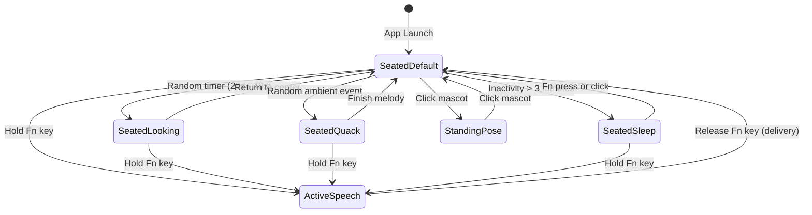

<!-- language: English -->
# Microduck Desktop Companion — Architecture & Design Specification

An authoritative specification of the **Microduck Desktop Companion** in `sanblueᵈᵒᵗ voice-flow`. This document defines the mascot's role, persistent desktop behavior, anatomical proportions, 2D vector kinematics, color tokens, and window interaction model.

---

## 1. System Vision & Purpose

Microduck transitions from an ephemeral capture indicator (previously hidden after 1.2 seconds) into an interactive, persistent desktop companion on macOS:

1. **Persistent Presence:** Microduck remains visible on the desktop across the user session without occluding active workflows or stealing application focus.
2. **On-Demand Thought Bubble:** The dictation capsule (VU level meter, mode badge, and transcript status) appears exclusively while capturing speech via the `Fn` trigger; during idle periods, only the mascot is rendered.
3. **Movable with Screen Memory:** The user can drag Microduck to any screen corner or edge via mouse drag. Coordinates persist in `UserDefaults` (`microduck.screenPosition.x` and `microduck.screenPosition.y`).
4. **Thought-Bubble Placement:** In the primary orientation, the dictation thought-bubble capsule opens immediately adjacent to Microduck's head ($x = 60\text{ pt}$). Adaptive horizontal flipping (opening to the left when docked near the right display boundary) is scheduled in the roadmap backlog.
5. **Seated as Core Default State:** The canonical resting state is seated with forward-splayed legs and gentle foot-swinging. An explicit click toggles the upright standing pose.
6. **Ambient Expressiveness (Virtual Pet Model):** During quiet periods, Microduck exhibits subtle, low-frequency behaviors: gentle foot swaying, relaxed blinking, looking left and right, soft quacking/singing, or settling into a nap after extended inactivity.

---

## 2. Anatomical Proportions & Design Contracts

The mascot rig is derived from the *Newton* robotic biped platform, styled with the `sanblueᵈᵒᵗ` retro aesthetic.

```
       [   Visor Helmet (Cream #EDECE6)   ]
       [   Golden Cyclops Camera Eye       ]
       [   Upper Bill (Orange #FF8C00)    ]
       [== Lower Articulated Jaw ========]
                     ||
              [Neck Joint (Navy)]
                     ||
       +---------------------------------+
       |  White Torso Shell              |
       |         SBdot   (o) Cyan Dot    |
       +---------------------------------+
       | Pelvis Beam (Dual Metal Pivots) |
       +---------------------------------+
         /                             \
   [Thigh Guard]                 [Thigh Guard]
   [Chunky Orange Foot]          [Chunky Orange Foot]
```

### Proportions & Coordinate Benchmarks

| Component | Dimensions / Offsets | Design Intent |
|---|---|---|
| **Canvas Bounding Box** | $170 \times 200\text{ pt}$ | Scaled uniformly via aspect-fit into $60 \times 82\text{ pt}$ frame. |
| **Torso Shell** | $46 \times 32\text{ pt}$ (Radius $10\text{ pt}$) | Cream shell (`#EDECE6`) with $12\text{ pt}$ cylindrical 3D shade on the right. |
| **Pelvis Frame** | $48 \times 14\text{ pt}$ (Radius $4\text{ pt}$) | Solid navy (`#16213E`) with two silver circular pivot fasteners. |
| **Thigh Segment** | Length $12.0\text{ pt}$ | Shortened from legacy 16 pt to lower the center of gravity and match Newton proportions. |
| **Shin Segment** | Length $12.0\text{ pt}$ | Symmetrical lower joint ending in chunky foot bracket. |
| **Foot Splay (Seated)** | Width $17\text{ pt}$, Height $21\text{ pt}$ | Dual orange feet splayed forward ($\pm 24^\circ$) with gold soles. |
| **Head Hood** | Width $60\text{ pt}$, Height $38\text{ pt}$ | Visor hood with centered golden eye lens (`#EFC15E`) and cyan sensor pupil (`#7CB3E8`). |
| **Articulated Jaw** | Width $54\text{ pt}$, Depth $5\text{ pt}$ | Deep orange (`#EA580C`) lower bill dropping up to $14\text{ pt}$ based on audio decibels. |

---

## 3. Chest Wordmark Optical Centering

The white torso shell features a cylindrical bevel with a $12\text{ pt}$ shade cap on the right edge. Mathematical centering must balance the **visible white front face** rather than the full bounding box to prevent visual rightward drift:

```
+-------------------------------------------+
| <--- 7px ---> [ SBdot ] <--- 7px ---> [Shade]
|               (20px)                  (12px)
+-------------------------------------------+
|<---------- White Face (34px) -------->|
```

- **Torso Total Width:** $46\text{ pt}$ (spanning from $x - 23$ to $x + 23$).
- **Right Shade Width:** $12\text{ pt}$ (spanning from $x + 11$ to $x + 23$).
- **Visible White Front Face:** Spans from $x - 23$ to $x + 11$ (total width $34\text{ pt}$).
- **Optical Center:** $x_{\text{center}} = x - 6\text{ pt}$.
- **Wordmark Typography:**
  - `SB`: Navy (`#16213E`), weight 800, size $9\text{ pt}$ monospaced.
  - `dot`: Dot Blue (`#7CB3E8`), weight 900, size $5.6\text{ pt}$ monospaced, raised by $3.4\text{ pt}$ superscript.
  - Total text width $\approx 20\text{ pt}$.
- **Symmetrical Margins:**
  - Left margin to outer shell: **$7.0\text{ pt}$**.
  - Right margin to shade boundary: **$7.0\text{ pt}$**.
- **Upper Right Cyan Accent Dot:** A solid circle of radius $2.3\text{ pt}$ in `#7CB3E8` at $(x_{\text{center}} + 18, y_{\text{center}} - 8)$, matching official mascot assets.

---

## 4. Color Tokens & Visual Identity

All rendering complies with canonical `VoiceStationTokens`:

```swift
// Canonical design system tokens in VoiceStationTokens:
// VoiceStationTokens.navy            // Frame joints & primary typography (#16213E)
// VoiceStationTokens.inputCream      // Main body & head hood (#FFF9E9)
// VoiceStationTokens.panelHeader     // 3D bevel shading
// VoiceStationTokens.dotBlue         // Superscript dot, pupil & accents (#7CB3E8)
// VoiceStationTokens.duckOrange      // Upper bill & outer feet (#F26B1D)
// VoiceStationTokens.duckOrangeDeep  // Lower articulated jaw (#C9561A)
// VoiceStationTokens.gold            // Sole pads & eye camera ring (#EFC15E)
// VoiceStationTokens.micHighlight    // Joint pivot rivets (#2C3A63)
// VoiceStationTokens.okOnDark        // State LED awake/listening
// VoiceStationTokens.rec             // State LED on air / active speech
```

---

## 5. Behavioral State Machine

The mascot operates under an autonomous, low-resource state machine driven by SwiftUI `TimelineView`:



### State Specifications

1. **`seatedDefault` (Core Base State):**
   - Microduck sits with legs splayed forward.
   - Thigh stabilizers folded laterally.
   - Both feet swing smoothly side-to-side ($\sin(\text{phase}) \times 10^\circ$) at $0.3\text{ Hz}$.
   - Occasional natural blink every 4 to 6 seconds.
2. **`seatedLooking` (Curiosity & Turn):**
   - Head and neck pivot smoothly left ($\approx -14^\circ$) and right ($\approx +14^\circ$).
   - Perspective shift on the visor plate simulates 3D depth.
3. **`seatedQuack` (Song / Expression):**
   - Neck elongates upward by $8\text{ pt}$.
   - Lower bill drops and closes rhythmically ($14\text{ pt}$ amplitude) with ambient music notes.
4. **`seatedSleep` (Nap Mode):**
   - Triggered when no dictation occurs for 3 consecutive minutes.
   - Neck relaxes forward ($+5^\circ$), head bows ($+12^\circ$), camera eyelid closes.
   - Small "Zzz" particles ascend slowly at $0.2\text{ Hz}$.
5. **`activeSpeech` (Push-to-Talk Recording):**
   - Triggered by holding the global `Fn` shortcut.
   - The thought bubble emerges with live audio level VU meters.
   - Lower jaw drops dynamically proportional to live microphone volume.
6. **`standingPose` (Click-to-Stand Toggle):**
   - Clicking Microduck toggles the standing pose.
   - Upright alert stance with compact $12\text{ pt}$ legs and centered pelvis.
   - Subsequent click returns to the canonical seated base.

---

## 6. Window Management & Interaction Model

### A. Non-Activating Draggable Panel
The floating window (`FloatingHUDPanel: NSPanel`) maintains:
- `styleMask = [.nonactivatingPanel, .borderless]`
- `level = .floating`
- `collectionBehavior = [.canJoinAllSpaces, .fullScreenAuxiliary]`
- `backgroundColor = .clear`
- `hasShadow = false`

Mouse interaction is restricted to the mascot frame using an active hit-testing rect. Clicks outside the mascot silhouette pass through directly to underlying applications (`ignoresMouseEvents = false` only over Microduck).

### B. Drag & Drop Gesture
Window movement is handled via the AppKit hosting view subclass (`MicroduckHUDHostingView`), ensuring seamless window positioning without dragging lags or SwiftUI view hierarchy contention:
- `mouseDown`: Records the initial window origin and mouse screen coordinates.
- `mouseDragged`: Translates delta coordinates, updates `window.setFrameOrigin(clampedPoint)`, and clamps the frame within the visible screen area (`screenRect.visibleFrame`).
- `mouseUp`: If dragged, fires `onWindowDragEnded` to commit the position to `UserDefaults`; if a tap with minimal displacement occurred, triggers `onDuckClicked` to toggle sitting/standing posture.

### C. Persistent Storage
The window position is saved to `UserDefaults.standard` under two Double keys: `microduck.screenPosition.x` and `microduck.screenPosition.y`. On application launch, if the position resides within visible screen bounds (`screen.visibleFrame.intersects(...)`), it is restored; otherwise, it defaults to the bottom-left corner of the primary display (`screenRect.minX + 24.0`, `screenRect.minY + 24.0`).

---

## 7. Verification & Reference Files

- **Dedicated Authoritative Mockups:**
  - `docs/microduck-sitting-mockup.html` (Canonical seated companion model, foot swinging, gaze tracking, sleep Zzz and quack overlays).
  - `docs/microduck-standing-mockup.html` (Biped standing mascot model, 12 pt thighs/shins, 22-second walk/hop/quack kinematics loop).
- **Interactive Simulator:** `docs/microduck-companion-simulator.html` in the repository.
- **Historical Reference Proposals:** `docs/microduck-mascot-01.html` and `docs/hud-redesign-01-microduck.html`.
- **Active Swift Implementations:**
  - `macos/Sources/VoiceFlowMac/MicroduckView.swift` (Vector Canvas & Poses).
  - `macos/Sources/VoiceFlowMac/FloatingHUDController.swift` (Panel lifecycle & drag).
  - `macos/Sources/VoiceFlowMac/RetroMicHUDView.swift` (Bubble coordination).
