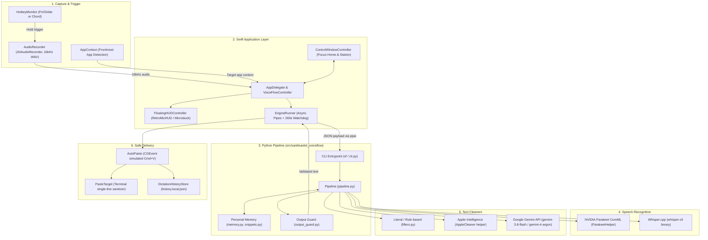

<!-- language: English -->
# VoiceFlow Architecture, Hierarchy & Operational Walkthrough

An operational guide to `sanblueᵈᵒᵗ voice-flow` for developers and incoming AI models. This document defines the end-to-end system architecture, repository structure, component boundaries, and execution rules.

---

## 1. End-to-End System Architecture

VoiceFlow is a low-latency, privacy-first dictation station on macOS. It operates through an isolated Swift application layer connected to a deterministic local Python engine via stdin/stdout Unix process pipes.



---

## 2. Directory Hierarchy & Component Map

```
sanblueᵈᵒᵗ voice-flow/
├── AGENTS.md                  # Operational standing orders and boundaries for this Mac
├── framework.md               # Normative product specification & requirements (R1–R9)
├── design-system.md           # Visual design contract, measurements, and tokens
├── backlog.md                 # Single active task list (defects D-*, improvements I-*)
├── proposal.md                # Active sequence of implementation work
├── relay-log.md               # Current working memory and baton handoff
├── README.md                  # Project overview, station commands, and usage
├── vf                         # Short shell wrapper for CLI engine commands
├── pyproject.toml             # Python package configuration and dependencies
│
├── src/sanbluedot_voiceflow/  # Core Python Engine
│   ├── pipeline.py            # End-to-end processing pipeline orchestrator
│   ├── output_guard.py        # Conservative cleanup guard (R4 lexical preservation)
│   ├── memory.py              # Learned corrections and vocabulary stores
│   ├── snippets.py            # Voice snippet expansion and macro store
│   ├── distill.py             # Distillation store for raw/cleaned pairs (local model training)
│   ├── practice.py            # Pronunciation practice audio and word scoring
│   ├── credentials.py         # macOS Keychain bridge for API credentials
│   ├── doctor.py              # System health and environment diagnostics
│   ├── cleaners/              # Text cleanup implementations
│   │   ├── fillers.py         # Rule-based filler removal and punctuation
│   │   ├── apple.py           # Apple Intelligence Writing Tools cleaner
│   │   └── gemini.py          # Gemini API cleaner (single-model / argon)
│   └── transcribers/          # Speech-to-text adapters
│       ├── parakeet.py        # NVIDIA Parakeet CoreML runner
│       └── whisper_cpp.py     # Whisper.cpp CLI runner and silence detection
│
├── macos/                     # macOS Native Swift Application Layer
│   ├── Package.swift          # Swift Package Manager manifest
│   ├── Sources/
│   │   ├── VoiceFlowMacCore/  # Pure Swift business logic (testable without UI)
│   │   │   ├── StationState.swift      # Badge states (READY, ON AIR, PROCESSING, FAILED)
│   │   │   ├── Configuration.swift     # Models, cleaners, speech engines, shortcuts
│   │   │   ├── DictationHistory.swift  # History records and store durability
│   │   │   ├── VoiceSnippet.swift      # Snippet store with file locking & quarantine
│   │   │   ├── Words.swift             # Vocabulary and correction diffing logic
│   │   │   ├── AppContext.swift        # Active application resolution and categories
│   │   │   ├── PasteTarget.swift       # Terminal safety checks and flattening
│   │   │   └── CleanerFacts.swift      # Factual provider capabilities and timing
│   │   ├── VoiceFlowMac/      # Main Application UI & Logic
│   │   │   ├── AppDelegate.swift       # App lifecycle and store coordination
│   │   │   ├── VoiceFlowController.swift # Capture and event handling
│   │   │   ├── EngineRunner.swift      # Subprocess runner with watchdog
│   │   │   ├── HotkeyMonitor.swift     # CGEventTap global hotkey listener
│   │   │   ├── AutoPaste.swift         # Accessibility-based synthetic paste
│   │   │   ├── AudioRecorder.swift     # AVAudioRecorder wrapper
│   │   │   ├── Keychain.swift          # Security framework wrapper
│   │   │   ├── VoiceStationWindowView.swift # Main window UI and tokens
│   │   │   ├── FocusHomeView.swift     # Multi-panel station and settings view
│   │   │   ├── MicroduckView.swift     # Articulated mascot HUD (30 FPS TimelineView, kinematics)
│   │   │   ├── RetroMicHUDView.swift   # On-screen HUD pill and level meter
│   │   │   └── FloatingHUDController.swift # Borderless floating HUD window
│   │   └── VoiceFlowAppleCleaner/      # On-device Apple Intelligence helper
│   │       └── AppleCleaner.swift      # CLI helper for Writing Tools
│   └── ParakeetHelper/        # Parakeet Speech Recognition Subproject
│       └── Sources/VoiceFlowParakeet/main.swift # FluidAudio CoreML helper
│
├── docs/                      # Technical Documentation & Visual References
│   ├── WalkthroughHierarchy.md # This guide
│   ├── proposals/             # Historical proposal documents
│   │   ├── phase-5-proposal.md
│   │   └── competitive-evolution-proposal.md
│   └── *.html                 # HTML/CSS interactive design prototypes
│
├── gates/                     # Closed Cold Adversarial Audit Run Logs
│   ├── README.md              # Historical index of all completed audit runs
│   └── *.local.md             # Individual run logs (excluded from Git)
│
├── tests/                     # Python Test Suite
│   └── test_*.py              # Unit tests covering pipeline, guard, CLI, and stores
│
├── scripts/                   # Build and Operational Scripts
│   ├── build-macos-app.sh     # Native bundle build and code-signing
│   ├── generate-xcodeproj.py  # Generates macos/VoiceFlow.xcodeproj
│   └── cleaner_gate.py        # Latency and quality benchmark harness
│
└── windows/                   # Windows Platform Adapter
    └── [EXCLUDED]             # Strictly excluded on macOS (do not read or audit)
```

---

## 3. Data Flow & Execution Sequence

### A. Speech Capture to Clipboard Delivery
1. **Trigger**: User presses and holds the configured shortcut (default: `Fn/Globe`). `HotkeyMonitor` detects the event tap.
2. **Recording**: `AudioRecorder` captures microphone audio to a temporary 16kHz WAV file. While held, `RetroMicHUDView` displays the audio level VU meter.
3. **Context Capture**: `AppContext.resolve()` detects the frontmost application bundle ID (e.g., Xcode, VS Code, Terminal, Slack) and assigns an `AppCategory`.
4. **Release & Dispatch**: Releasing the key stops recording. `EngineRunner` launches the engine process:
   ```bash
   python3 -m sanbluedot_voiceflow process --audio <path> --mode <mode> --cleaner <cleaner>
   ```
5. **Speech Transcription**: The engine calls either NVIDIA Parakeet (via `ParakeetHelper` CoreML) or Whisper.cpp. Silent takes are refused.
6. **Personalization & Vocabulary**: `memory.py` applies confirmed word corrections. `snippets.py` expands configured triggers (e.g., `!sig` -> signature).
7. **Cleanup**: Text is refined by the selected cleaner:
   - `Literal`: Rule-based filler elimination (`cleaners/fillers.py`).
   - `Apple`: On-device Foundation Models via `AppleCleaner`.
   - `Gemini`: Google Gemini API (`gemini-3.8-flash` or `gemini-4-argon`).
8. **Conservative Output Guard**: `output_guard.py` enforces Rule R4. If the cleanup changed lexical meaning, altered numbers, or added unsupported words, the cleanup is rejected and the safe transcript is used.
9. **Delivery**: `AutoPaste.swift` posts a synthetic `Cmd+V`. If pasting into a terminal, text is sanitized to a single line to prevent accidental execution.
10. **Storage & Feedback**: The dictation record is appended to `DictationHistoryStore`, and `FloatingHUDController` displays completion latency and words-per-minute.

---

## 4. Operational Boundaries & Rules for Models

When working in this repository, all models and developers must adhere to these rules:

### Rule 1: Windows Platform Exclusion
`windows/` belongs to a separate machine. On this Mac:
- **Do NOT** read `windows/`.
- **Do NOT** audit `windows/` or plan tasks for it.
- **Do NOT** include Windows-only Python modules (`desktop.py`, `cleaners/ollama.py`) in reviews.

### Rule 2: Git Commit Authority
- The repository workspace is managed with strict commit boundaries.
- **Sandy alone commits and pushes.**
- Prepare code cleanly, verify builds, and leave changes unstaged or staged as requested; never commit or push unless explicitly instructed.

### Rule 3: Privacy & Zero Background Telemetry (R7)
- No background network connections or model requests are permitted.
- External connections (such as checking Gemini API status or model latency) occur **only upon explicit user action**.
- Never log raw transcripts or audio to external tracking servers.

### Rule 4: Data Durability & Store Resilience (R5)
- All personal stores (`DictationHistoryStore`, `VoiceSnippetStore`, `memory.py`) must write atomically or with file locks.
- If a store file cannot be decoded due to corruption, **it must never be silently overwritten with an empty store**.
- Corrupted stores must be renamed aside with a dated timestamp (`.corrupt-YYYYMMdd-HHmmss`) and the loss reported.

### Rule 5: Deriving Identifiers
- When adding defect IDs (`D-*`), improvement IDs (`I-*`), or file sequences, derive the number from `highest value present + 1`.
- **Never count items**, as deleted items create numbering collisions that destroy data.

---

## 5. Mandatory Verification Cycle

Run these four checks after making code changes:

```bash
# 1. Python Unit Tests
PYTHONPATH=src python3 -m unittest discover -s tests

# 2. Python Compilation Check
PYTHONPATH=src python3 -m compileall -q src tests scripts

# 3. Swift Package Build
swift build --package-path macos

# 4. Swift Core Checks Target
swift run --package-path macos VoiceFlowMacCoreChecks
```

Rebuild the installed application bundle only when delivering changes for daily desktop use:
```bash
zsh scripts/build-macos-app.sh
```
