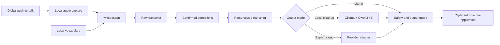

# Project Proposal: sanblueᵈᵒᵗ VoiceFlow

> **Owner:** private  
> **Status:** Approved for phased implementation  
> **Platforms:** macOS. The Windows adapter is owned and measured on the Windows machine and is not worked from here.  
> **Updated:** 2026-08-31

## Purpose

sanblueᵈᵒᵗ VoiceFlow is a personal push-to-talk dictation application. Holding the Fn/Globe key captures speech by default, local speech recognition transcribes Spanish, English, or a mixture of both, and an optional text model applies conservative cleanup before the result reaches the active application. The trigger remains configurable.

The product is for one user on two known computers. It does not need multi-tenant infrastructure, enterprise administration, mobile clients, or a large model-routing platform.

`framework.md` is the normative product and acceptance specification. This proposal owns the implementation direction and sequence.

## Product principles

1. **Local first:** audio and personal vocabulary remain on the device by default.
2. **Literal before clever:** the raw transcript is always available; cleanup must not change meaning.
3. **Fast path first:** ordinary dictation uses local models. Cloud rewriting is explicit and optional.
4. **One working platform at a time:** this repository's work is the Mac implementation.
5. **Explicit learning:** corrections enter memory only after the user confirms them.
6. **Replaceable providers:** speech and cleanup models sit behind small interfaces rather than controlling the application architecture.

## Initial architecture

### Model responsibilities

| Layer | Initial choice | Responsibility |
|---|---|---|
| Speech recognition | `whisper.cpp` | Local transcription and automatic language detection |
| Local text cleanup | Ollama with `qwen3:4b` | Punctuation, filler removal, and conservative formatting |
| Cloud cleanup | Gemini with `gemini-3.5-flash` | Optional higher-quality cleanup; text only; Gate 4 closed 2026-08-31 |

Cloud model IDs are configuration, not permanent architecture. Gemini is the selected
first cloud provider and `gemini-3.5-flash` is the configured default, with 3.6 and 3.7
selectable and used as automatic fallbacks. Which model is default follows measured
delivery, not the version number. Groq is only a possible later
comparison: adding it requires new explicit authorization and the same privacy,
fallback, output-guard, corpus-quality, latency, and cost evidence. No Anthropic or
OpenAI connector is current planned work. Every provider must implement the same small
cleanup contract.

## Personalization

The application improves through controlled local state:

- a vocabulary list for names, acronyms, academic terms, and brand words;
- confirmed pairs of misheard text and intended text;
- output preferences for literal, conservative, and rewrite modes;
- optional application-specific formatting preferences.

This is prompt and correction memory, not continuous acoustic-model training. Silent collection of surrounding screen content, keystrokes, or unconfirmed edits is outside scope.

## Privacy and safety

- Audio stays local unless a future mode clearly states otherwise before capture.
- Cloud providers receive text only in the initial design.
- API keys belong in the operating-system credential store, never project files.
- The raw transcript remains recoverable when cleanup fails.
- Terminal output defaults to clipboard delivery. Automatic paste requires a later explicit safety decision.
- A focus change during processing must not send text to an unintended application.

## Delivery sequence

| Phase | Deliverable | Gate |
|---|---|---|
| 0 | Proposal, framework, governance, and repository-safe scaffold | Markdown and structural checks pass |
| 1 | File-to-text engine: WAV → `whisper.cpp` → literal/local cleanup → stdout or clipboard | Automated tests pass; real bilingual sample set is transcribed |
| 2 | macOS live capture and push-to-talk | Hold/release works across the agreed Mac applications |
| 3 | Confirmed vocabulary and correction memory | Repeated test terms improve without regressions |
| 4 | One optional cloud cleanup provider | No audio leaves the device; failure returns to the local path |
| 5 | Menu-bar interface and settings | Packaged Mac app passes the acceptance matrix |

**These phase numbers are not the gate numbers in `framework.md`, and the two must not
be read as one sequence.** When they disagree, `framework.md` governs, because it is the
normative specification.

## Pronunciation practice

Added 2026-08-29 as `framework.md` R8 and Gate 6, outside the phase sequence above and
independent of cloud work. A mis-transcription against a text the speaker
chose is acoustic evidence about the speaker, and the engine already produces it for
free. The application reports which words it failed to recover and keeps the recording
to replay; it assigns no score and states no phonetic diagnosis, because teaching
belongs to the separate English tutor that reads these results. This is the same
principle as the rest of the product: surface evidence, never invent judgement.

## First implementation slice

The first code slice is deliberately small:

- a Python 3.11+ engine package;
- a `whisper.cpp` command adapter;
- literal and Ollama cleanup adapters;
- a pipeline that preserves the raw transcript;
- cross-platform clipboard output;
- a diagnostic command;
- unit tests with no downloaded model required.

Live microphone capture, the global shortcut, cloud APIs, persistent personal memory, automatic paste, and the graphical shell begin only after this slice passes.

## Success measures

The Mac gate uses the owner's M3 Pro, 18 GB computer and a controlled sample set containing Spanish, English, mixed-language speech, names, numbers, URLs, and technical vocabulary.

- All automated engine tests pass.
- The raw field never changes the transcript returned by the speech engine; literal
  final output differs only through explicitly confirmed deterministic corrections.
- A cleanup failure returns an actionable error without destroying the raw transcript.
- Twenty short recordings complete without a crash.
- Release-to-result latency is measured at p50 and p95 after warm-up; the first benchmark establishes the release target rather than inventing one.
- Accuracy is reported separately from latency using a fixed reference transcript.
- Clipboard delivery succeeds in the agreed test applications; terminal auto-paste is not part of this gate.

## Current constraints

- The development Mac now has `whisper.cpp`, Ollama, `qwen3:4b`, Whisper Small, and
  large-v3-turbo provisioned and verified locally. They remain external dependencies and
  are not bundled with the source tree.
- The native Phase 2 runner is built and signed locally. It opens a visible control window,
  remains available from the Dock and menu bar, and supports both one large hold button
  and Fn/Globe. Its automated checks pass, the stable macOS permissions are approved,
  and Gate 2 passed 20/20 ordered global hold/release recordings without a crash or stuck
  state. Clipboard delivery passed in Notes, Safari, and VS Code.
- The private Phase 2 baseline records 1.90-second p50 latency, 2.27-second p95 latency,
  25.6% raw WER, and 26.9% cleaned WER. The local cleaner did not improve aggregate
  accuracy. Later fixed-audio replay points to English, not mixed speech, as the main
  remaining recognition weakness; the cleaner remains opt-in until separately accepted.
- Gate 5 is owned, measured and reported on the Windows machine, which works from its
  own copy and needs no briefing from here. `acceptance/phase-5-acceptance.md` is its
  runbook and the only place its state is recorded. A session working on this Mac does
  not read `windows/`, audit it, report on it or plan it.
- macOS microphone and Accessibility permissions require visible user consent.

## Noted for later — Shortcuts, Xcode, and local intent parsing

Recorded 2026-09-16. Not scheduled, not authorized, and not part of the interface work
in progress. It is written here so the reasoning is not lost, not because it is next.

**Siri cannot be the transcriber, and the question was the wrong one.** Verified
2026-09-18 against Apple's documentation: `SpeechAnalyzer` and its `SpeechTranscriber`
module, both introduced in version 26, are a supported on-device transcription API. Siri
itself still exposes nothing an application can receive, but the platform does, so the
alternative to `whisper.cpp` is that framework rather than Siri. It is a candidate like
any other and faces `scripts/cleaner_gate.py`'s corpus before it replaces anything.

The original claim, kept because its reasoning still applies to Siri itself: The claim is that Apple exposes no way for an application to receive what Siri
heard, which would make this a platform limit before a privacy one. Check it against
Apple's developer documentation before the note is acted on. The owner stated
on 2026-09-16 that Siri reaching Apple's servers is acceptable to her, which removes the
objection to using Siri as a trigger but changes nothing about the limit above. If a Siri
path is ever added, `README.md` and R2/R7 stop being true as written and must be
corrected in the same change; the claim that speech never leaves the machine is not a
slogan to keep once a path contradicts it.

**Shortcuts can be the hands.** The useful direction is the opposite one: the engine
transcribes locally, the intent is resolved locally, and the result invokes a Shortcut,
which already carries a large library of system actions. Nothing is spoken to Apple, and
the Mac still does the work. This replaces neither `VoiceAction.swift` nor the paste
path; it is a third delivery target beside clipboard and keystroke.

**A local model could replace the regex intent parser.** `VoiceAction.swift` matches
fixed patterns and has already failed on ordinary Spanish — an accented application name
cannot be parsed at all, because the capture class is `[A-Za-z0-9\s]`. A local Ollama
model would read intent in either language without a pattern list. R3c currently requires
spoken intents to be parsed *deterministically*, so this is a framework decision before it
is an implementation: a model is not deterministic, and the requirement would have to say
what replaces that guarantee.

**The packaging blocks App Intents. Verified 2026-09-18.** The cheap test was run:
`PingVoiceFlowIntent` in `Sources/VoiceFlowMac/VoiceFlowIntents.swift` compiles cleanly,
and the SwiftPM build produces no App Intents metadata at all — the product directory
holds the executables and nothing else. Xcode generates that metadata with
`appintentsmetadataprocessor`, which ships in its toolchain and which SwiftPM never runs.
So the actions exist in code and the system cannot see them.

Siri, Spotlight and Shortcuts therefore need an Xcode project for this app. The intent
stays in place as the first thing to check once that project exists; it performs nothing.
Two facts make the migration cheaper than it sounds: the Swift sources are unchanged by
Xcode, which compiles the same files the script does, and `Package.swift` now publishes
`VoiceFlowMacCore` as a library, which is what an Xcode target links. Apple's
`AppIntentsPackage` covers intents declared outside the app bundle, so the intents may
live in that library rather than in the executable.
